  

# Hi there!

  

### 💻 IT Student | Aspiring Software Engineer

### 💻 About Me

- 🎓 IT Student at HUIT passionate about **Software Engineering**
- ⚡ Strong foundation in Data Structures, Algorithms, Object-Oriented Programming (OOP), and Database Management
- 🌐 Experienced in building Desktop Applications (.NET) and Web APIs
- 🛠️ Tech Skills: C#, Python, SQL, Git & Web Technologies

## 🛠️ Languages and Tools

  

## 🔥 GitHub Streak

---

### Thanks for visiting my profile! ⭐

